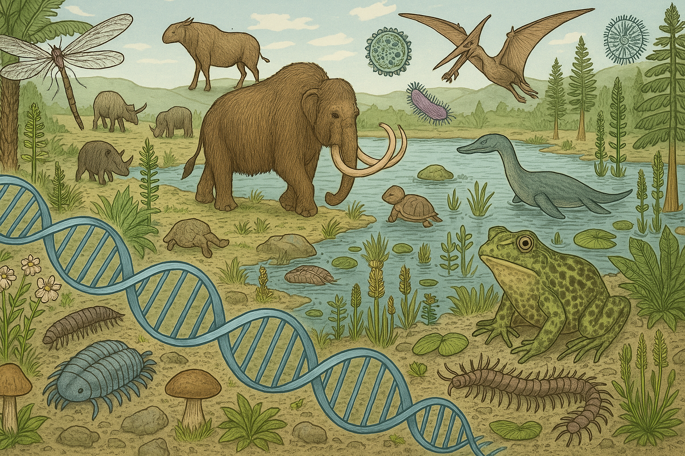

# Ancient Environmental Metagenomics

## Instructor

- Dr. Nikolay Oskolkov, Metabolic Research Group leader (PI), National Institute of Research and Innovation (NIRI), Riga, Latvia, and Biology Department, Lund University, Sweden

## Course overview
The study of ancient microbial, animal, and plant DNA from environmental samples, such as sediments, ice, and permafrost, is a rapidly expanding field with significant potential for uncovering insights into past ecosystems, biodiversity, and environmental change. However, the limited quantity and degraded quality of ancient DNA, together with the complex mixture of organisms present in environmental samples, pose significant challenges to computational analysis. In this course, we will explore the key challenges and analytical methods in ancient environmental metagenomics, focusing on a comprehensive understanding and practical implementation of two complementary workflows: aMeta, for ancient metagenomic analysis, and aeMeta, a newly developed workflow tailored specifically to ancient environmental metagenomics. In addition, we will introduce GENEX, a reference genome decontamination tool designed to remove contamination from reference genomes and thereby improve the accuracy and reliability of downstream analyses.

## Target audience and assumed background
We assume some basic awareness of UNIX environment, as well as at least beginner level of R and / or Python programming.

## Learning outcomes
By completing this course, you will:

- Understand the basics of ancient microbial and environmental metagenomic analysis
- Have an overview of bioinformatic tools and best practices for ancient environmental metagenomic analysis
- Be able to apply aMeta, aeMeta and GENEX workflows to your ancient environmental metagenomic samples
- Know key challenges, approaches and solutions in the ancient environmental metagenomics research field
- Be able to choose the right tools and approaches to answer your specific research question 

---

# Schedule

## Before the course

| Time   | Activity                                                                                           | Link                                                                                                            |
|--------|----------------------------------------------------------------------------------------------------|------------------------------------------------------------------------------------------------------------------------------------------|
| ~ 1 h  | Recorded talk: aMeta presented at the Microbiome Virtual International Forum (MVIF) 2024           | [Video](https://www.youtube.com/watch?v=nIWpmUWAapM&t=39s)                                                                                          |
| ~ 1 h  | Recorded talk: False-positives in ancient metagenomics, aMeta approach, SPAAMtish 2023             | [Video](https://www.youtube.com/watch?v=KUf0auYHjrc&t=405s)                                                                                         |
| ~ 2 h  | aMeta ancient microbial metagenomic method article in Genome Biology 2023                          | [PDF](https://github.com/NikolayOskolkov/AncientEnvironmentalMetagenomics/blob/main/articles/aMeta_GenomeBiology_2023.pdf)                                                                                 |
| ~ 1 h  | Useful reading: Fungal DNA in the gut of Tyrolean Iceman (Ötzi)                                    | [PDF](https://github.com/NikolayOskolkov/AncientEnvironmentalMetagenomics/blob/main/articles/Oskolkov_BMC_Genomics_2025.pdf)                                                                               |
| ~ 1 h  | Useful reading: Detecting microbial contaminamination in eukaryotic reference genomes              | [PDF](https://github.com/NikolayOskolkov/AncientEnvironmentalMetagenomics/blob/main/articles/Oskolkov_GigaScience_2025.pdf)                                                                                |
| ~ 1 h  | Useful reading: Refining filtering criteria for taxonomic profiling of ancient metagenomics data   | [PDF](https://github.com/NikolayOskolkov/AncientEnvironmentalMetagenomics/blob/main/articles/Oskolkov_FrontiersMicrobiology_2026.pdf)                                                                      |
| ~ 1 h  | In case needed: Recap on Unix                                                                      | [Lab](command-line-basics.md)                                                                                   |

## Day 1: 3 pm - 9 pm Swedish time

| Time           | Activity                                                                                   | Link                                                                                                            |
|----------------|--------------------------------------------------------------------------------------------|------------------------------------------------------------------------------------------------------------------------------------------|
| 15.00 - 16.00  | Course outline and practical information, introduction of instructor and participants      | [Slides](https://github.com/NikolayOskolkov/AncientEnvironmentalMetagenomics/blob/main/slides/course-outline-and-practical-info.pdf)                                                                                           |
| 16.00 - 17.00  | Introduction to metagenomics and ancient environmental metagenomics analysis               | [Slides](https://github.com/NikolayOskolkov/AncientEnvironmentalMetagenomics/blob/main/slides/introduction-to-metagenomics.pdf)                                                                                             |
| 17.00 - 17.30  | Practical: preparing and copying data and setting up compute environment at Google Colab   | [Lab](https://html-preview.github.io/?url=https://github.com/NikolayOskolkov/AncientEnvironmentalMetagenomics/blob/main/practicals/Day1/Day1_setup.html)                                                                    |
| 17.30 - 18.30  | Break                                                                                      |                                                                                                                 |
| 18.30 - 19.30  | Quality control, adapter trimming host organisms removal                                   | [Slides](https://github.com/NikolayOskolkov/AncientEnvironmentalMetagenomics/blob/main/slides/Lecture_QC_AdapterRemoval.pdf)                                                                                |
| 19.30 - 21.00  | Practical: Quality control and adapter trimming with fastp and cutadapt                    | [Lab](https://html-preview.github.io/?url=https://github.com/NikolayOskolkov/AncientEnvironmentalMetagenomics/blob/main/practicals/Day1/Day1_QC.html)                                                                       |

## Day 2: 3 pm - 9 pm Swedish time

| Time           | Activity                                                                                   | Link                                                                                                            |
|----------------|--------------------------------------------------------------------------------------------|------------------------------------------------------------------------------------------------------------------------------------------|
| 15.00 - 16.30  | Introduction: challenges in ancient microbial and environmental metagenomics analysis      | [Slides](https://github.com/NikolayOskolkov/AncientEnvironmentalMetagenomics/blob/main/slides/Lecture_IntroAncientMetagenomics.pdf)                                                                         |
| 16.30 - 17.30  | Practical: human host removal with Bowtie2 alignment                                       | [Lab](https://html-preview.github.io/?url=https://github.com/NikolayOskolkov/AncientEnvironmentalMetagenomics/blob/main/practicals/Day1/Day1_QC.html)                                                                       |
| 17.30 - 18.30  | Break                                                                                      |
| 18.30 - 20.00  | Taxonomic profiling and filtering criteria                                                 | [Slides](https://github.com/NikolayOskolkov/AncientEnvironmentalMetagenomics/blob/main/slides/Lecture_TaxonomicProfiling.pdf)                                                                               |
| 20.00 - 21.00  | Practical: taxonomic profiling in microbial and environmental ancient metagenomics         | [Lab](exercises.md#read-based-taxonomic-profiling)                                                                                                    |

## Day 3: 3 pm - 9 pm Swedish time

| Time           | Activity                                                                                   | Link                                                                                                            |
|----------------|--------------------------------------------------------------------------------------------|------------------------------------------------------------------------------------------------------------------------------------------|
| 15.00 - 16.00  | Authentication analysis: genomic hit confirmation and ancient status                       | [Slides](https://github.com/NikolayOskolkov/AncientEnvironmentalMetagenomics/blob/main/slides/Lecture_Authentication.pdf)                                                                                   |
| 16.00 - 17.30  | Practical: genomic hit confirmation by evenness of coverage and damage pattern             | [Lab](https://github.com/NikolayOskolkov/AncientEnvironmentalMetagenomics/blob/main/exercises.md#genomic-hit-confirmation)                                                                                                 |
| 17.30 - 18.30  | Break                                                                                      |                                                                                                                 |
| 18.30 - 19.30  | Decontamination analysis of metegenomic data and eukaryotic reference genomes              | [Slides](https://github.com/NikolayOskolkov/AncientEnvironmentalMetagenomics/blob/main/slides/Lecture_Decontamination.pdf)                                                                                  |
| 19.30 - 21.00  | Practical: microbial contamination correction and source tracking                          | [Lab](https://github.com/NikolayOskolkov/AncientEnvironmentalMetagenomics/blob/main/exercises.md#microbiome-contamination-correction)                                                                                     |

## Day 4: 3 pm - 9 pm Swedish time

| Time           | Activity                                                                                   | Link                                                                                                                                     |
|----------------|--------------------------------------------------------------------------------------------|------------------------------------------------------------------------------------------------------------------------------------------|
| 14.00 - 14.15  | Bonus lecture: UMAP vs. PCA for population genomics and ancient metagenomics               | [Slides](https://github.com/NikolayOskolkov/AncientEnvironmentalMetagenomics/blob/main/slides/UMAP_NBIS_AI_IO_2025_Oskolkov.pdf)       |
| 17.00 - 18.00  | Decontamination analysis of metegenomic data and eukaryotic reference genomes              | [Slides](https://github.com/NikolayOskolkov/AncientEnvironmentalMetagenomics/blob/main/slides/Lecture_Decontamination.pdf)             |
| 18.00 - 18.15  | Break                                                                                      |                                                                                                                                        |
| 18.15 - 20.00  | Practical: microbial contamination correction and source tracking                          | [Lab](exercises.md#microbiome-contamination-correction)                                                                                  |

## Day 5: 3 pm - 9 pm Swedish time

| Time           | Activity                                                                                   | Link                                                                                                                                     |
|----------------|--------------------------------------------------------------------------------------------|------------------------------------------------------------------------------------------------------------------------------------------|
| 14.15 - 15.00  | aMeta: an accurate and memory-efficient ancient metagenomic profiling workflow             | [Slides](https://github.com/NikolayOskolkov/AncientEnvironmentalMetagenomics/blob/main/slides/Lecture_aMeta.pdf)                       |
| 15.00 - 15.15  | Break                                                                                      |                                                                                                                                          |
| 15.15 - 16.45  | Practical: aMeta ancient metagenomic workflow                                              | [Lab](exercises.md#ameta-introduction-and-installation)                                                                                  |
| 16.45 - 17.00  | Break                                                                                      |                                                                                                                                          |
| 17.00 - 18.00  | Metagenome de-novo assembly, quality control, authentication of assembled contigs          | [Slides](https://github.com/NikolayOskolkov/AncientEnvironmentalMetagenomics/blob/main/slides/Lecture_Assembly.pdf)                    |
| 18.00 - 18.15  | Break                                                                                      |                                                                                                                                          |
| 18.15 - 19.30  | Practical: de-novo assembly, quality control, authentication                               | [Lab](exercises.md#metagenome-assembly)                                                                                                  |
| 19.30 - 20.00  | Questions an discussion                                                                    |                                                                                                                                          |

